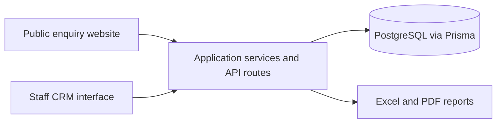
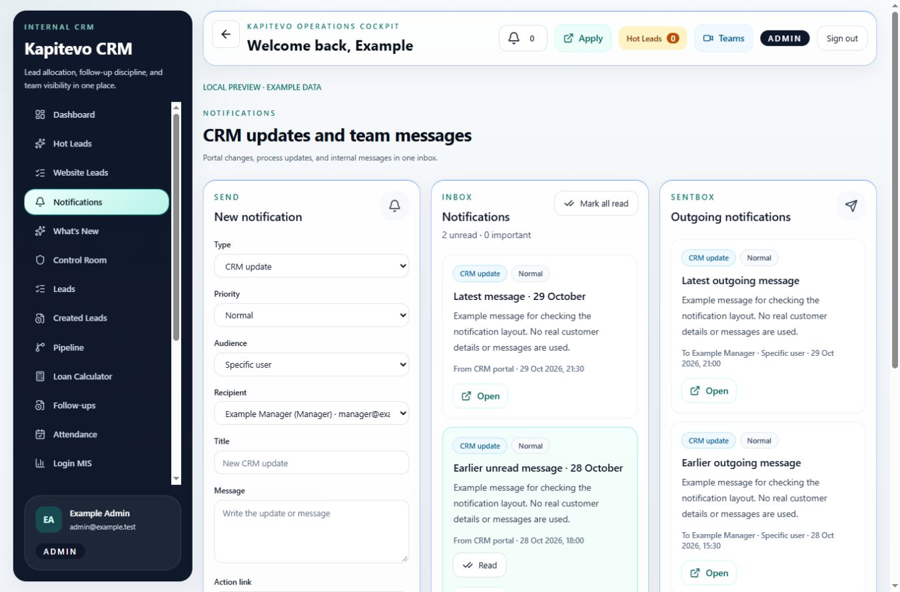

# Kapitevo CRM

**Loan Operations & Workflow Automation**

A full-stack CRM for managing loan enquiries, customer leads, follow-ups, lender processing, payouts and employee services in one workspace.

**Live application:** [crm.kapitevo.com](https://crm.kapitevo.com) — sign-in required.

> The implementation is maintained in a private client repository. This showcase contains project documentation and a sample-data preview. It does not include application source code or real customer records.

## Main features

| Area | Functionality |
| --- | --- |
| Lead management | Customer records, ownership, follow-ups, planned visits and case history. |
| Daily assignment | Campaign-first allocation with fallback, plus configurable product percentages for individual users. |
| Website enquiries | Enquiry capture, mobile-based status tracking and a shared queue for new hot leads. |
| Lender processing | Required customer-detail validation, loan programs, approved interest rates and tenure. |
| Business reporting | Operational dashboards, performance tables and focused worklists. |
| Payouts and invoicing | Bank-specific commercial profiles, billing cycles, invoice previews and PDF generation. |
| Employee services | Monthly incentives, salary revisions and reviewed employee document requests. Salary slips use recorded fixed salary. |
| Data handling | Excel/CSV imports, duplicate review, exports and field-level permissions. |
| Notifications | Incoming and outgoing messages, read status and responsive desktop/mobile layouts. |

## Technology stack

- **Frontend:** Next.js, React, TypeScript and Tailwind CSS.
- **Backend:** Next.js server components and API routes running on Node.js.
- **Database:** PostgreSQL with Prisma ORM and migrations.
- **Reports:** ExcelJS and pdf-lib.
- **Quality:** ESLint, TypeScript checks and automated integration/regression tests.
- **Delivery:** Git, GitHub Actions and Railway.

## Architecture overview

## Engineering focus

- Server-side validation and access checks alongside the user interface.
- Consistent lead status, ownership and activity history across workflows.
- Concurrent claim and update safeguards for shared work.
- Effective-dated commercial and salary settings.
- Regression tests for calculations, workflow transitions, imports and access boundaries.
- Responsive interfaces verified at desktop and mobile widths.

## Sample-data preview

The following preview uses synthetic names and messages. It shows the notification workspace with Send, Inbox and Sentbox aligned on desktop.

## Portfolio details

**Project type:** Full-stack web development.

**Skills:** Next.js, React, TypeScript, Node.js, PostgreSQL, SQL, Prisma, Tailwind CSS, REST APIs, Git, CI/CD and integration testing.

The live application is intended for authorized staff. This repository provides a public project overview rather than a runnable demo or implementation source.
